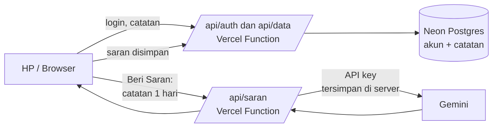

## MOBILE SUPPORT ONLY

<p align="center">
  
</p>

<p align="center">
  <b>Catat pengeluaran dan penghasilan harian, lalu minta saran dari AI.</b><br>
  Satu layar untuk melihat minggu, bulan, atau tahun. Punya akun sendiri, datanya tersimpan di database Neon.
</p>

<p align="center">
  
  
  
  
  <a href="https://instagram.com/apap09_"></a>
</p>

> **Cal adalah proyek pribadi** yang dibuat untuk dipakai sendiri. Datanya disimpan di akun masing-masing (database Neon), dan saran AI memakai API key Gemini gratis. Dukungan bersifat sebisanya (best-effort).

<br>

## Fitur

| | |
|---|---|
| **Catat dalam hitungan detik** | Tekan **+**, pilih **Pengeluaran** atau **Penghasilan**, isi nominal dan deskripsi (opsional) untuk masing-masing, lalu **Confirm**. Keduanya bisa diisi sekaligus, dan deskripsinya tidak saling tercampur. Nominal otomatis berformat rupiah. |
| **Analisis Tahun / Bulan / Minggu** | Garis merah untuk pengeluaran, garis hijau untuk penghasilan. Ganti periodenya lewat tombol di bawah grafik: **Minggu** (7 hari), **Bulan** (tiap tanggal), atau **Tahun** (12 bulan), lengkap dengan total periode dan tombol ‹ › untuk melihat periode sebelumnya. Ketuk grafik untuk membuka hari atau bulan itu. |
| **Kalender Senin–Minggu** | Mengikuti tanggal di HP. Setelah lewat tengah malam hari Minggu, tabel otomatis pindah ke minggu baru dan kembali ke Senin. |
| **Minta Saran AI** | Ketuk sebuah hari, lalu minta AI menunjukkan letak kesalahan, hal yang perlu diperbaiki, dan hal yang perlu ditingkatkan. |
| **Ubah dan hapus catatan** | Ketuk catatan untuk mengubah, ✕ untuk menghapus. Saran lama otomatis dibuang bila catatan hari itu berubah. |
| **Akun sendiri** | Daftar dengan Gmail, username, dan password, lalu login. Setelah login, Cal langsung terbuka sampai kamu menekan **Logout**. Catatan tersimpan di database Neon per akun. |
| **Ekspor / Impor / Hapus** | Di Pengaturan: **Ekspor JSON** untuk backup, **Impor JSON** memasukkan catatan ke akun yang sedang login, **Hapus semua data** mengosongkan catatan akun, dan **Hapus akun** menghapus akun beserta isinya (dengan peringatan berlapis). |
| **Bisa dipasang** | Dipasang ke layar utama seperti aplikasi biasa. Karena data ada di server, Cal butuh internet untuk memuat dan menyimpan catatan. |

<p align="center">
  
</p>
<p align="center"><sub>Tampilan asli aplikasi dengan data contoh. Isi saran AI di gambar hanyalah contoh.</sub></p>

## Pakai Cal

1. Buka link Cal di browser HP, tekan **Selanjutnya**, lalu **Daftar** (Gmail, username, password). Berikutnya cukup **Login**; setelah itu Cal langsung terbuka sampai kamu **Logout** (Pengaturan, ikon gerigi).
2. Menu browser → **Tambahkan ke layar utama** (Chrome Android) atau **Bagikan → Tambah ke Layar Utama** (Safari iPhone).
3. Tekan **+** di tengah bawah untuk mencatat, lalu pilih Pengeluaran atau Penghasilan. Tekan sebuah hari di kalender untuk melihat rinciannya, atau pakai tombol **Tahun / Bulan / Minggu** di bawah grafik untuk mengganti periode analisis.
4. Besoknya, tekan hari kemarin lalu **Beri Saran**.

## Deploy sendiri

hanya butuh GitHub, Vercel, dan database [Neon](https://neon.com) (gratis), tanpa build command.

1. Unggah semua file proyek ke repository GitHub (folder `api/`, `icons/`, dan `docs/` ikut).
2. Di Vercel: **Add New → Project** → pilih repository → **Deploy**. Framework Preset: *Other*.
3. Buat database Neon: di Vercel buka **Storage → Create Database → Neon** dan hubungkan ke project ini. Variabel `DATABASE_URL` otomatis ditambahkan. (Cara manual: buat project di [neon.com](https://neon.com), salin *connection string* yang **pooled**, lalu simpan sebagai `DATABASE_URL`.) Tabel dibuat otomatis saat aplikasi pertama dipakai, tidak perlu menjalankan SQL.
4. Di **Settings → Environment Variables**, pastikan ada:

   | Nama | Isi |
   |---|---|
   | `DATABASE_URL` | *connection string* Neon (otomatis bila memakai integrasi Vercel) |
   | `GEMINI_API_KEY` | API key dari [Google AI Studio](https://aistudio.google.com/) |
   | `GEMINI_MODEL` | *(opsional)* default `gemini-3.5-flash-lite` |

5. **Redeploy** agar variabel terbaca.
6. Ganti link GitHub di halaman Developer: buka `index.html`, cari komentar `GANTI link repo`, lalu ubah `href` di bawahnya ke repo-mu.

## Cara kerja



- **Frontend:** HTML, CSS, dan JavaScript murni tanpa framework dan tanpa build. Grafik digambar dengan SVG.
- **Akun:** password disimpan sebagai hash scrypt (tidak pernah sebagai teks biasa). Login membuat sesi acak yang disimpan di cookie `HttpOnly` dan di database, berlaku sampai Logout. Semua kueri catatan dibatasi ke akun yang sedang masuk.
- **Penyimpanan:** database Neon (Postgres), tabel `users`, `sessions`, `tx`, dan `advice`. Tiap catatan adalah satu baris (tanggal, jenis, nominal, deskripsi), jadi mencatat dua kali sehari tidak saling menimpa, dan pengeluaran serta penghasilan masing-masing punya deskripsi sendiri.
- **Saran AI:** satu serverless function di `api/saran.js` yang memanggil Gemini. API key hanya ada di Vercel, tidak pernah dikirim ke browser. Hasil saran disimpan per hari, jadi hari yang sama tidak memanggil Gemini dua kali.
- **PWA:** `manifest.json` dan `sw.js` membuat Cal bisa dipasang ke layar utama. Data dibaca dan disimpan lewat server, jadi perlu internet.

### Struktur proyek

```
index.html  style.css  app.js     aplikasi (frontend)
sw.js  manifest.json  icons/      PWA
api/saran.js                      endpoint Gemini
api/auth.js                       daftar, login, logout, hapus akun
api/data.js                       catatan dan saran milik akun
api/_db.js  api/_auth.js          pendukung: koneksi Neon, password, sesi
docs/readme/                      gambar untuk README
vercel.json  package.json
```

## Privasi dan data

- Catatan dan akun disimpan di **database Neon milik pemilik aplikasi**. Tiap akun hanya bisa membaca dan mengubah catatannya sendiri, tetapi pemilik database secara teknis dapat melihat isinya. Jangan menulis data yang sangat sensitif.
- Saat **Minta Saran AI**, nominal dan deskripsi catatan **satu hari itu** dikirim ke Gemini lewat server. Pada paket gratis, Google dapat memakai data tersebut untuk pengembangan produk. Hindari menulis data sensitif di deskripsi.
- Catatan ikut akun, jadi tetap ada saat ganti HP atau membersihkan cache. **Hapus akun** dan **Hapus semua data** bersifat permanen, jadi **Ekspor JSON** dulu bila perlu.
- Endpoint Beri Saran (`/api/saran`) tidak meminta login dan dibatasi 6 permintaan per menit per IP.

## Kredit

- **Saran AI:** [Google Gemini](https://ai.google.dev/).
- **Hosting:** [Vercel](https://vercel.com).
- **Live Website:** [Open](https://catatankeuangan-orpin.vercel.app/).
- **Font:** font sistem perangkat, tanpa unduhan tambahan.

## Developer

<p>
  Dibuat oleh <b>Al_</b>.<br>
  Instagram: <a href="https://instagram.com/apap09_">@apap09_</a>
</p>

<sub>Cal tidak berafiliasi dengan Google atau Vercel. Gemini adalah merek dagang Google LLC. Vercel adalah merek dagang Vercel Inc. Saran AI bersifat informatif dan bukan nasihat keuangan profesional.</sub>
