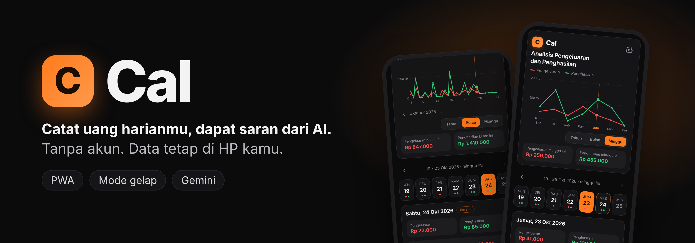
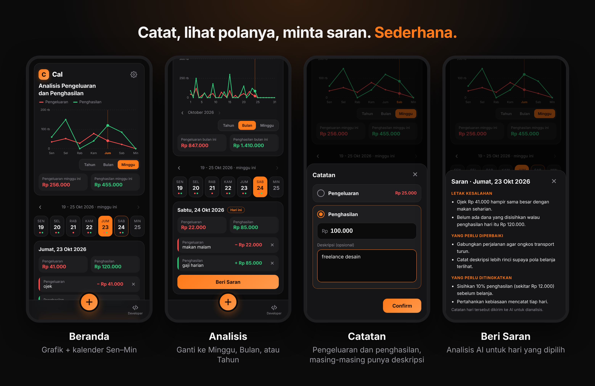
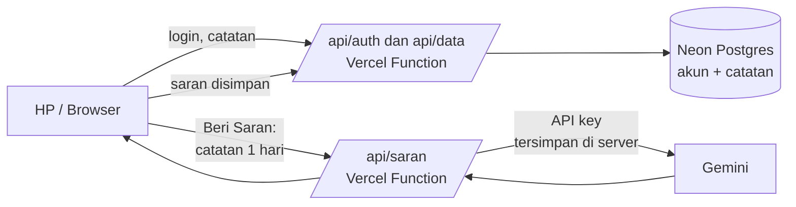

## MOBILE SUPPORT ONLY

<p align="center">
  
</p>

<p align="center">
  <b>Catat pengeluaran dan penghasilan harian, lalu minta saran dari AI.</b><br>
  Satu layar untuk melihat minggu, bulan, atau tahun. Punya akun sendiri, datanya tersimpan di database Neon.
</p>

<p align="center">
  
  
  
  <a href="https://instagram.com/apap09_"></a>
</p>

<br>

## Fitur

| | |
|---|---|
| **Catat dalam hitungan detik** | Tekan **+**, pilih **Pengeluaran** atau **Penghasilan**, isi nominal dan deskripsi (opsional) untuk masing-masing, lalu **Confirm**. Keduanya bisa diisi sekaligus, dan deskripsinya tidak saling tercampur. Nominal otomatis berformat rupiah. |
| **Analisis Tahun / Bulan / Minggu** | Garis merah untuk pengeluaran, garis hijau untuk penghasilan. Ganti periodenya lewat tombol di bawah grafik: **Minggu** (7 hari), **Bulan** (tiap tanggal), atau **Tahun** (12 bulan), lengkap dengan total periode dan tombol ‹ › untuk melihat periode sebelumnya. Ketuk grafik untuk membuka hari atau bulan itu. |
| **Kalender Senin–Minggu** | Mengikuti tanggal di HP. Setelah lewat tengah malam hari Minggu, tabel otomatis pindah ke minggu baru dan kembali ke Senin. |
| **Minta Saran AI** | Ketuk sebuah hari, lalu minta AI menunjukkan letak kesalahan, hal yang perlu diperbaiki, dan hal yang perlu ditingkatkan. |
| **Ubah dan hapus catatan** | Ketuk catatan untuk mengubah, ✕ untuk menghapus. Saran lama otomatis dibuang bila catatan hari itu berubah. |
| **Akun sendiri** | Daftar dengan Gmail, username, dan password, lalu login. Setelah login, Cal langsung terbuka sampai kamu menekan **Logout**. Catatan tersimpan di database Neon per akun. |
| **Lupa password** | Di halaman Login, tekan **Lupa password?**: isi Gmail akun, tekan **Kirim kode** (jeda 1 menit untuk kirim ulang), ketik kode 6 angka dari email, lalu username tampil dan kamu mengisi password baru. Kode berlaku 10 menit, sekali pakai, dan dibatalkan setelah 5 kali salah. Setelah password diganti, semua perangkat harus login ulang. Akun admin bawaan memakai email palsu, jadi isi Gmail asli di **Kelola** dulu bila admin ingin memakai fitur ini. |
| **Dialog kustom** | Konfirmasi logout, impor, hapus catatan, hapus semua data, dan hapus akun memakai dialog bawaan Cal (bukan dialog browser): muncul dengan gerak pegas, ikon tergambar, tombol bergaya tuts, dan kartunya bisa digeser ke bawah untuk menutup. Scrollbar disembunyikan, halaman tetap bisa digulir. |
| **Target Barang** | Footer punya tab **Beranda** dan **Target** (di kiri tombol +). Di Target, tekan + untuk membuat target: nama dan harga barang wajib, foto opsional (otomatis dikecilkan). Tiap target punya catatan tabungan **Nabung / Tarik** (saldo tidak bisa minus). Saat saldo mencapai harga muncul "udah cukup ni bro". **Sudah beli, tutup tabungan** memindahkan target ke daftar *Sudah terbeli* (dua dialog konfirmasi); **Batal beli, hapus target** menghapus detail dan catatan tabungannya (dua dialog konfirmasi). Tombol Simpan/Buat memakai konfirmasi tekan-dua-kali. Hapus akun ikut menghapus semua target. |
| **Lihat / sembunyikan password** | Ikon mata di kolom password pada halaman Login, Daftar, dan lembar akun. |
| **Akun (pengguna)** | Tombol **Akun** di kiri tombol Developer: ubah username, Gmail, dan password sendiri. Ganti password wajib mengisi password saat ini, dan perangkat lain otomatis keluar. |
| **Kelola (admin)** | Akun bawaan **admin** (username `admin`, password `admin`) melihat tombol **Kelola** di tempat yang sama: mencari akun lewat Gmail, username, atau password (cocok persis), lalu mengubah Gmail, username, atau password akun mana pun, termasuk akun admin sendiri. **Segera ganti password admin setelah deploy pertama.** Akun admin tidak bisa dihapus dan username `admin` dicadangkan. |
| **Ekspor / Impor / Hapus** | Di Pengaturan: **Ekspor JSON** untuk backup, **Impor JSON** memasukkan catatan ke akun yang sedang login, **Hapus semua data** mengosongkan catatan akun, dan **Hapus akun** menghapus akun beserta isinya (dengan peringatan berlapis). |
| **Bisa dipasang** | Dipasang ke layar utama seperti aplikasi biasa. Karena data ada di server, Cal butuh internet untuk memuat dan menyimpan catatan. |

<p align="center">
  
</p>
<p align="center"><sub>Tampilan asli aplikasi dengan data contoh.</sub></p>

## Mode offline (catatan harian)
- Catatan yang pernah dimuat saat online tersimpan di perangkat, jadi tetap tampil saat offline. Catatan baru dari perangkat lain tidak muncul sampai online lagi.
- Catatan yang dibuat, diubah, atau dihapus saat offline disimpan dulu di perangkat dan dikirim otomatis ke database begitu internet kembali. Di Beranda muncul label "Offline" / "n belum tersinkron".
- Login pertama harus online. Setelah itu aplikasi bisa dibuka offline (sesi berlaku 400 hari). Bila sesi sudah habis, kamu diminta login lagi dan antrean tetap dikirim.
- Target Barang juga bisa offline: daftar target dan riwayat tabungan yang pernah dibuka tersimpan di perangkat. Target baru, nabung/tarik, tutup tabungan, dan batal beli yang dibuat offline dikirim otomatis saat online.
- Keluar akun butuh internet, dan menghapus data lokal. Chat AI, saran AI, impor/ekspor, dan kelola akun tetap butuh internet. Analitik memakai catatan yang sudah tersimpan di perangkat.
- Pembungkus APK (WebToNative): pastikan cookie dan penyimpanan lokal tidak dihapus tiap aplikasi ditutup, kalau tidak login offline tidak bertahan.

## Menu Lainnya, Chat AI, dan Analitik
- Tombol **Lainnya** di pojok kanan footer membuka menu: Chat AI, Analitik, dan Developer.
- **Chat AI** hanya membahas catatan keuangan dan tabungan akunmu. Server mengambil data akunmu sendiri (ringkasan per bulan, catatan terbaru, target dan riwayat tabungan) dan AI hanya menyebut bagian yang kamu tanya. Memakai `GEMINI_API_KEY` yang sama dengan Beri Saran (tidak ada variabel baru).
- **Analitik** per bulan: ringkasan kondisi keuangan, perbandingan pemasukan/pengeluaran dengan bulan sebelumnya, dan laporan lengkap (tunai vs non tunai, per minggu, pengeluaran terbesar).
- Setiap catatan kini punya metode **Tunai** atau **Non Tunai** (catatan lama tetap tanpa metode). Kolom `method` ditambahkan otomatis ke tabel `tx` saat permintaan pertama.

## Pakai Cal
1. Buka link Cal di browser HP, tekan **Selanjutnya**, lalu **Daftar** (Gmail, username, password). Berikutnya cukup **Login**; setelah itu Cal langsung terbuka sampai kamu **Logout** (Pengaturan, ikon gerigi).
2. Menu browser → **Tambahkan ke layar utama** (Chrome Android) atau **Bagikan → Tambah ke Layar Utama** (Safari iPhone).
3. Tekan **+** di tengah bawah untuk mencatat, lalu pilih Pengeluaran atau Penghasilan. Tekan sebuah hari di kalender untuk melihat rinciannya, atau pakai tombol **Tahun / Bulan / Minggu** di bawah grafik untuk mengganti periode analisis.
4. Besoknya, tekan hari kemarin lalu **Beri Saran**.

## Cara kerja



- **Frontend:** HTML, CSS, dan JavaScript murni tanpa framework dan tanpa build. Grafik digambar dengan SVG.
- **Akun:** password disimpan sebagai hash scrypt (tidak pernah sebagai teks biasa). Login membuat sesi acak yang disimpan di cookie `HttpOnly` dan di database, berlaku sampai Logout. Semua kueri catatan dibatasi ke akun yang sedang masuk.
- **Penyimpanan:** database Neon (Postgres), tabel `users`, `sessions`, `tx`, dan `advice`. Tiap catatan adalah satu baris (tanggal, jenis, nominal, deskripsi), jadi mencatat dua kali sehari tidak saling menimpa, dan pengeluaran serta penghasilan masing-masing punya deskripsi sendiri.
- **Saran AI:** satu serverless function di `api/saran.js` yang memanggil Gemini. API key hanya ada di Vercel, tidak pernah dikirim ke browser. Hasil saran disimpan per hari, jadi hari yang sama tidak memanggil Gemini dua kali.
- **PWA:** `manifest.json` dan `sw.js` membuat Cal bisa dipasang ke layar utama. Data dibaca dan disimpan lewat server, jadi perlu internet.

### Struktur proyek

```
index.html  style.css  app.js     aplikasi (frontend)
sw.js  manifest.json  icons/      PWA
api/saran.js                      endpoint Gemini
api/auth.js                       daftar, login, logout, lupa password, ubah profil, kelola admin, hapus akun
api/data.js                       catatan dan saran milik akun
api/_db.js  api/_auth.js          pendukung: koneksi Neon, password, sesi
api/_mail.js                      pendukung: kirim email kode lewat Gmail SMTP
api/goals.js                      target barang dan catatan tabungan
docs/readme/                      gambar untuk README
vercel.json  package.json
```

## Privasi dan data

- Catatan dan akun disimpan di **database Neon milik pemilik aplikasi**. Tiap akun hanya bisa membaca dan mengubah catatannya sendiri, tetapi pemilik database secara teknis dapat melihat isinya. Jangan menulis data yang sangat sensitif.
- Saat **Minta Saran AI**, nominal dan deskripsi catatan **satu hari itu** dikirim ke Gemini lewat server. Pada paket gratis, Google dapat memakai data tersebut untuk pengembangan produk. Hindari menulis data sensitif di deskripsi.
- Catatan ikut akun, jadi tetap ada saat ganti HP atau membersihkan cache. **Hapus akun** dan **Hapus semua data** bersifat permanen, jadi **Ekspor JSON** dulu bila perlu.
- Endpoint Beri Saran (`/api/saran`) tidak meminta login dan dibatasi 6 permintaan per menit per IP.

## Kredit

- **Saran AI:** [Google Gemini](https://ai.google.dev/).
- **Hosting:** [Vercel](https://vercel.com).
- **Live Website:** [Open](https://catatankeuangan-orpin.vercel.app/).
- **Font:** font sistem perangkat, tanpa unduhan tambahan.
- **Thanks2:** [median.co](https://median.co) and [Acode](https://acode.app)
## Developer

<p>
  Dibuat oleh <b>Al_</b>.<br>
  Instagram: <a href="https://instagram.com/apap09_">@apap09_</a>
</p>

<sub>Cal tidak berafiliasi dengan Google atau Vercel. Gemini adalah merek dagang Google LLC. Vercel adalah merek dagang Vercel Inc. Saran AI bersifat informatif dan bukan nasihat keuangan profesional.</sub>
