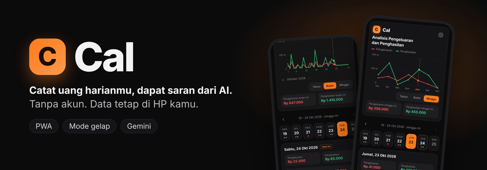
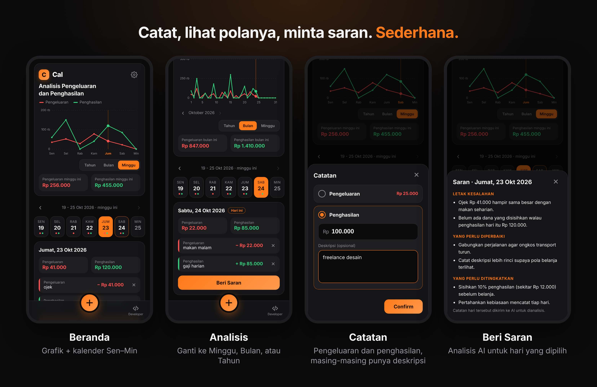
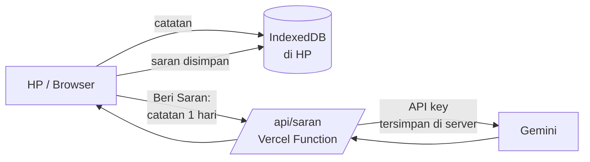

## MOBILE SUPPORT ONLY

<p align="center">
  
</p>

<p align="center">
  <b>Catat pengeluaran dan penghasilan harian, lalu minta saran dari AI.</b><br>
  Satu layar. Satu minggu. Tanpa akun, tanpa database server.
</p>

<p align="center">
  
  
  
  
  <a href="https://instagram.com/apap09_"></a>
</p>

> **Cal adalah proyek pribadi** yang dibuat untuk dipakai sendiri dan teman-teman. Datanya disimpan di HP masing-masing, dan saran AI memakai API key Gemini gratis. Dukungan bersifat sebisanya (best-effort).

<br>

## Apa yang Cal lakukan

| | |
|---|---|
| **Catat dalam hitungan detik** | Tekan **+**, isi pengeluaran dan/atau penghasilan, deskripsi opsional, lalu **Confirm**. Nominal otomatis berformat rupiah. |
| **Grafik satu minggu** | Garis merah untuk pengeluaran, garis hijau untuk penghasilan, lengkap dengan total mingguan. |
| **Kalender Senin–Minggu** | Mengikuti tanggal di HP. Setelah lewat tengah malam hari Minggu, tabel otomatis pindah ke minggu baru dan kembali ke Senin. |
| **Beri Saran** | Ketuk sebuah hari, lalu minta AI menunjukkan letak kesalahan, hal yang perlu diperbaiki, dan hal yang perlu ditingkatkan. |
| **Ubah dan hapus catatan** | Ketuk catatan untuk mengubah, ✕ untuk menghapus. Saran lama otomatis dibuang bila catatan hari itu berubah. |
| **Data tetap di HP** | Disimpan di IndexedDB. Ada **Ekspor/Impor JSON** untuk backup dan pindah HP. |
| **Jalan offline** | Dipasang ke layar utama seperti aplikasi biasa. Hanya Fitur "Beri Saran" yang butuh internet. |

<p align="center">
  
</p>
<p align="center"><sub>Tampilan asli aplikasi dengan data contoh. Isi saran AI di gambar hanyalah contoh.</sub></p>

## Cara Pakai

1. Buka link Cal di browser HP.
2. Menu browser → **Tambahkan ke layar utama** (Chrome Android) atau **Bagikan → Tambah ke Layar Utama** (Safari iPhone).
3. Tekan **+** di tengah bawah untuk mencatat. Tekan sebuah hari di kalender untuk melihat rinciannya.
4. Besoknya, tekan hari kemarin lalu **Beri Saran**.

## Deploy sendiri

Cal hanya butuh GitHub dan Vercel, tanpa build command.

1. Unggah semua file proyek ke repository GitHub (folder `api/`, `icons/`, dan `docs/` ikut).
2. Di Vercel: **Add New → Project** → pilih repository → **Deploy**. Framework Preset: *Other*.
3. Di **Settings → Environment Variables**, tambahkan:

   | Nama | Isi |
   |---|---|
   | `GEMINI_API_KEY` | API key dari [Google AI Studio](https://aistudio.google.com/) |
   | `GEMINI_MODEL` | *(opsional)* default `gemini-3.5-flash-lite` |

4. **Redeploy** agar variabel terbaca.
5. Ganti link GitHub di halaman Developer: buka `index.html`, cari komentar `GANTI link repo`, lalu ubah `href` di bawahnya ke repo-mu.

## Cara kerja



- **Frontend:** HTML, CSS, dan JavaScript murni tanpa framework dan tanpa build. Grafik digambar dengan SVG.
- **Penyimpanan:** IndexedDB di browser. Tiap catatan adalah satu baris (tanggal, jenis, nominal, deskripsi), jadi mencatat dua kali sehari tidak saling menimpa.
- **Saran AI:** satu serverless function di `api/saran.js` yang memanggil Gemini. API key hanya ada di Vercel, tidak pernah dikirim ke browser. Hasil saran disimpan per hari, jadi hari yang sama tidak memanggil Gemini dua kali.
- **PWA:** `manifest.json` dan `sw.js` membuat Cal bisa dipasang dan tetap terbuka saat offline.

### Struktur proyek

```
index.html  style.css  app.js     aplikasi (frontend)
sw.js  manifest.json  icons/      PWA
api/saran.js                      endpoint Gemini
docs/readme/                      gambar untuk README
vercel.json  package.json
```

## Privasi dan data

- Catatan **tidak disimpan di server**. Semuanya ada di browser HP masing-masing, dan tiap pengguna datanya terpisah.
- Saat **Beri Saran**, nominal dan deskripsi catatan **satu hari itu** dikirim ke Gemini lewat server. Pada paket gratis, Google dapat memakai data tersebut untuk pengembangan produk. Hindari menulis data sensitif di deskripsi.
- Data hilang bila data situs/cache browser dihapus atau ganti HP. **Ekspor JSON secara berkala.**
- Cal tidak memakai login atau kode akses. Siapa pun yang tahu link bisa memakai Beri Saran dan memakai kuota Gemini gratis pemilik. Server membatasi 6 permintaan per menit per IP sebagai pengaman ringan.
- Satu browser = satu data. Membuka link yang sama di browser lain akan tampil kosong.

## Kredit

- **Saran AI:** [Google Gemini](https://ai.google.dev/).
- **Hosting:** [Vercel](https://vercel.com).
- **Live Website:** [Open](https://catatankeuangan-orpin.vercel.app/).
- **Font:** font sistem perangkat, tanpa unduhan tambahan.

## Developer

<p>
  Dibuat oleh <b>Al_</b>.<br>
  Instagram: <a href="https://instagram.com/apap09_">@apap09_</a>
</p>

<sub>Cal tidak berafiliasi dengan Google atau Vercel. Gemini adalah merek dagang Google LLC. Vercel adalah merek dagang Vercel Inc. Saran AI bersifat informatif dan bukan nasihat keuangan profesional.</sub>
